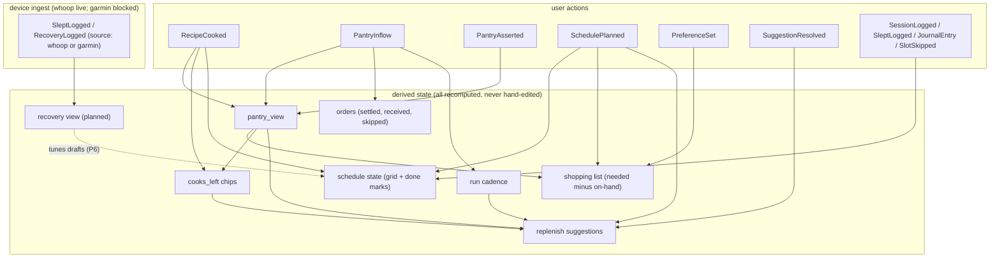

# DATAFLOW — the information model

**Status: ROUGH DRAFT v1 (2026-07-27).** Reconciled against the built headless backend (specs/backend-complete.md, PRs #20-26): all 21 event types below are live; "planned" now marks only what genuinely isn't built. Next revision proposes new dataflows on this baseline.

What this is: the single map of where every fact lives, what writes it, what reads it, and what changes when something happens. Screens and buttons come after this is signed off; every future surface is just a reader over this model. Companion to UX.md (behavior) and WORKPLAN.md (build order). Status legend: **live** = shipped and tested today; **planned** = not built (named so the model shows where it will plug in).

## 1. The one storage principle

Everything the household does or decides is one row in the **event diary** (`events` table): append-only, never edited, never deleted. Every other stored thing is a **cache of a fold** — a pure function that replays the diary and computes current state. Caches can be wiped and rebuilt from the diary at any time and must come back identical (this is tested). Consequence: adding intelligence later never requires new data collection — new readers replay the whole history ("later phases add readers, not rewrites").

## 2. Storage inventory

| Store | What it holds | Written by | Read by | Rebuildable? |
|---|---|---|---|---|
| `events` | The diary: every action, plan, log, suggestion, answer | every writer, append-only | every fold/reader | it IS the truth |
| `library` | Saved StructuredPlans (recipes + workout templates, `kind` column) | saveRecipe / saveWorkout on user save | cookbook + cart build + cook mode (recipes only), listWorkouts + progression + week proposer (workouts) | no — user content (source_url kept for re-extraction) |
| `pantry_view` | Current pantry (name, qty, unit, precision) | pantry fold, same transaction as its event | pantry page, cart diff, replenisher | yes — wipe + refold (tested) |
| `prefs_view` | Ingredient preferences {brand, size, note} | prefs fold, same transaction | list/run annotations; Matcher (planned) | yes — wipe + refold (tested) |
| `profile` | Goals, dials, defaults (empty today; goals live as GoalSet events instead) | profile UI (planned) | planners, calorie budget (both read GoalSet today) | no — stated truth |
| `wearable_tokens` | Whoop OAuth token pair (rotating refresh, compare-and-swap update) | whoop connect/refresh | whoop sync + webhook follow-up GETs | no — credentials |
| browser localStorage | In-progress store-run checkmarks only | run screen taps | run screen resume | discardable; truth lands as one event at "Done shopping" |

Rule: `household_id` on every row of every store, day 1.

## 3. Event catalog

The envelope every event shares: `{event_id, household_id, type, ts, source, payload, schema_version, precision}`. `source` = who wrote it ("web" = human in the app; "whoop"/"garmin" = device ingester, planned). `precision` = how much to trust the numbers (exact / estimated / guessed); math downstream always carries the weakest input's precision.

| Event | Status | Fired when | Payload core | Read by |
|---|---|---|---|---|
| RecipeSaved | live | user saves a reviewed extraction | library_id, title, source_url | (history/streaks later) |
| PantryAsserted | live | user states pantry truth (add/edit/remove) | name, qty, unit, removed?, expires? (user-stated date; an assertion without one clears it) | pantry fold (absolute: replaces accumulated state incl. expiry); expiring window → use-soon recipes |
| PantryInflow | live | groceries arrive: run "Done shopping" or delivery reconcile | items[], via, order_event_id? | pantry fold (+), order settling, run cadence, median purchase qty |
| OrderPlaced | live | a cart handed to a rail: instore run start or Instacart link | rail, items[], url? | orders list, requested-vs-actual pairing |
| RecipeCooked | live | "I made this" (quick-done or cook mode) | library_id, title, ingredients + nutrition snapshot (frozen at cook time — later recipe edits never rewrite history) | pantry fold (−), cooksLeft, meal-slot done-join, calorie budget, reflect |
| PreferenceSet | live | user states brand/size/note for an ingredient | name, brand, size, note (all-null clears) | prefs fold; Matcher training (planned) |
| WeekPlanned | live → superseded by SchedulePlanned | list build | recipes[{library_id,title}] | (replaced; old events ignored) |
| SuggestionMade | live | app surfaces a proposal (add-to-list chip; ease + next-target advice; repair menu; the week draft; the calorie trim) | suggestion_id, kind (add_to_list\|ease_workout\|next_target\|repair\|plan_draft\|nutrition_adjust), per-kind fields, reason | per-kind silencing rules, autonomy track record |
| SuggestionResolved | live | user answers a proposal, or the machine retires a drifted one | suggestion_id, kind (derived server-side from the open Made), outcome accepted\|dismissed\|superseded (superseded = machine bookkeeping, never a user verdict, excluded from track records) | per-kind silencing; every user answer is training data |
| SchedulePlanned | live | any schedule edit | days[{date, slots[{slot_id, lane, title, library_id?, priority?}]}] — snapshot, latest wins | schedule reader, cart build (current week's meal slots), replenish projections |
| SessionLogged | live | workout/class/sauna/yoga done (planned slot, spontaneous, or whoop-ingested) | slot_id?, title, structured\|loose, note, external_id?, session_id?, library_id? | schedule done-join; cadence goal progress; week-proposer rotation; program position; reflect |
| SleptLogged | live | nightly sleep log (manual or whoop) | date, quality, hours? | schedule done-join; reflect sleep trend; energy-aware budget (planned) |
| JournalEntry | live | mind-slot done or spontaneous journaling (optional mood 1-5, schema_version 2 when present) | text, slot_id?, mood? | schedule done-join; reflect prompts + mood trend |
| SlotSkipped | live | user skips any slot | slot_id, lane | schedule reader; meal-skip menus shift/drop; workout-skip menus the full repair set (lib/repair.ts, optional LLM re-rank) |
| RecoveryLogged | live | whoop ingester (lib/whoop-ingest.ts) or manual | date, score?, hrv?, resting_hr?, external_id? | recovery view → schedule decoration (advice: ease); planner draft halving on red |
| GoalSet | live | user states/revises/clears a goal (latest per goal_id wins) | goal_id, title, kind strength\|cadence\|custom\|nutrition, targets (incl. daily_calories) | goal progress; proposeWorkoutWeek; the calorie budget |
| ProgramSet | live | user sets/replaces the training block (singleton, latest wins) | title, per_week, start_monday, weeks[] (build\|volume\|peak\|deload) | programPosition (week/phase/ahead-behind); deload-aware drafting; reflect milestone |
| LogRetracted | live | user undoes a mis-tap (only the 6 human log types, RETRACTABLE_TYPES) | target event_id | every fold drops the target before reading; diary keeps both records forever |
| AutonomyRungSet | live | user sets a trust rung for a suggestion kind (latest per kind wins, default one_tap) | kind, rung review\|one_tap\|auto\|full_auto | autonomy state read; nothing auto-applies yet (deliberate) |
| SetLogged | live | in-workout set tracking, one event per set (durable mid-session) | session_id, exercise, set_index, reps, weight?, unit?, rpe?, slot_id?, library_id? | exercise history → nextTargets progression (per-exercise increment aware), goal progress |
| WorkoutSaved | live | workout template saved: manual entry or video extraction (kind: "workout" library row; source_url dedup on re-share) | library_id, title | listWorkouts, week proposer + planner rotation |

## 4. Propagation map — "when X happens, what changes"

In words, the load-bearing chains:
- **Cook a meal** → pantry quantities drop (unit-converted) → cooks_left chips update → the item may cross into "almost out" → next list build suggests it. The cook also marks its schedule slot done (joined by library_id + date — no second event).
- **Finish a grocery run** → one PantryInflow → pantry rises, the run's OrderPlaced settles (skipped items visible), run cadence updates, dismissed suggestions unmute (the world changed), median purchase amounts sharpen.
- **Edit the schedule** → new snapshot (slot_ids stable) → grid state, the shopping-list source (current week's meal slots), and replenish projections all recompute on next read. Nothing else moves — plans are intentions, not truth.
- **Assert pantry truth** → replaces accumulated state absolutely; every downstream reader (list, chips, suggestions) sees it next read. Stated beats learned, everywhere. Asserting an expiry date puts the item on the 7-day expiring window (GET /api/pantry `expiring`), which names the cookbook recipes that would use it (`use_soon`, also on the list build) — data only, nothing auto-scheduled.
- **Cook history accrues** → per-item weekly consumption rates (lib/consumption.ts weeklyUse, shipped 2026-07-26: ≥2 convertible cooks → qty/week in the item's unit, cold-start silent) ride GET /api/pantry as `weekly_use`; the diary is readable per lane at GET /api/history (meals | workouts | journal | sleep, device revisions collapsed latest-per-external_id). The golden-household eval (tests/golden-household.test.ts) pins every reader against one synthetic three-week diary.
- **Answer a suggestion** → logged forever; dismissals silence that item until the next settled run; the accept/dismiss trail is the future Replenisher/Matcher's training set.
- **Device data (shipped 2026-07-26, Whoop direct — specs/wearable-ingest.md)** → same event shapes a human writes (`RecoveryLogged`, `SleptLogged`, loose `SessionLogged`), tagged `source: "whoop"`, trusted `precision: "exact"`, identified by `payload.external_id` (redeliveries skip, revisions append, readers resolve latest-wins). Devices NEVER write pantry truth or the schedule *plan*; slot *status* is a derived join over logs, and a device log is as good a receipt as a tap — a Whoop night marks a sleep slot done, while device workouts never carry a slot_id (no auto-marking plans). Recovery decorates the schedule read (`recovery` + `advice: "ease"` on red-zone days with a planned workout) — and surfacing that advice logs the suggestion pair (`ease_proposals` on the day carries the open suggestion_id per still-planned workout slot; a dismissal silences that slot).

## 5. Transformation rules (the invariants every reader obeys)

1. **Units**: same-dimension converts exactly (lib/units.ts is the only converter); cross-dimension never invents math — degrade honestly (pantry: present-unknown; list: full-need line flagged "have some").
2. **Precision**: merged state carries the weakest input (exact < estimated < guessed). Conversion never changes precision. Device data arrives `exact`, manual taps `estimated`.
3. **Suggest-only**: no inference, agent, or device ever asserts pantry truth or edits the schedule *plan*. Only explicit user action writes those truth events; everything else is a SuggestionMade awaiting a SuggestionResolved. All six kinds now log the pair (add-to-list, ease, next-target, repair, plan_draft, nutrition_adjust); the one response-data-only advice left is `use_soon` recipe hints. Autonomy rungs are representable state but nothing reads them to auto-apply yet. Slot *status* is different — it's a derived join over logs, and device-written logs count as receipts (a Whoop night marks the sleep slot done).
4. **Snapshot-wins plans**: SchedulePlanned/prefs — latest event is current state; slot_ids/names give identity across snapshots.
5. **Receipts**: nothing renders "done" until its event write returns.
6. **Ignore-unknown**: every fold skips event types it doesn't know — new types never break old readers (tested).
7. **Cold-start honesty**: readers with insufficient history return nothing (no cadence < 2 runs → no suggestions), never a guess.
8. **Retraction rides the fold**: a LogRetracted event makes every reader drop its target (dropRetracted runs before every fold); the diary keeps both records forever, the zero-retraction path is byte-identical, and only the 6 human log types are retractable — device events never are.

## 6. Presentation contracts (what each surface reads — layout deferred)

| Surface (name only) | Reads | Writes |
|---|---|---|
| Today | schedule state (today's slots + done marks), cooks_left | RecipeCooked, SessionLogged, SleptLogged, JournalEntry, SlotSkipped |
| Schedule (2-week) | schedule state, library titles | SchedulePlanned |
| Shopping list | schedule (week-1 meals), pantry, prefs, suggestions | SuggestionResolved, edits stay local until execute |
| Store run | its OrderPlaced items, prefs, localStorage checks | OrderPlaced (start), PantryInflow (done), PreferenceSet |
| Pantry | pantry_view, cooks_left | PantryAsserted |
| Orders | orders reader (settled/received/skipped) | PantryInflow (delivery reconcile) |
| Cookbook / cook mode | library | RecipeSaved, RecipeCooked |
| Review/reflect (data live: /api/reflect) | whole diary (week lived vs planned, streaks, mood trend, one prompt) | JournalEntry (with mood) |
| Week draft (data live: /api/plan/draft + /api/plan/exchange) | library, goals, program position, recovery, budget | plan_draft SuggestionMade; applies only via POST /api/schedule |
| Program (data live: /api/program) | ProgramSet + session diary → position | ProgramSet |
| Trust / autonomy (data live: /api/autonomy) | rung per kind + accept/dismiss record | AutonomyRungSet |
| Undo (data live: /api/retract) | the target event | LogRetracted |

Page mapping (which of these share a screen, what buttons) is the next design pass, after this model is signed off.
