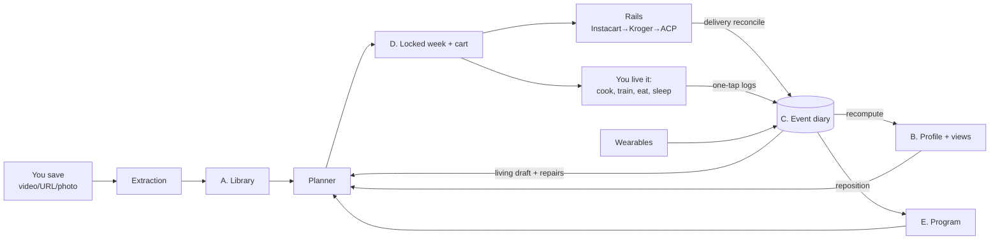

# Workplan: from the UX model to the system

**Status: ROUGH DRAFT v1 (2026-07-27).** The phase table below is the historical build order; it is now largely OVERTAKEN by the backend-complete push (specs/backend-complete.md, PRs #20-26), which pulled the data/intelligence layers of P3/P5/P6/P7 forward and shipped them headless. Where we actually are:

- **Shipped headless**: everything in DATAFLOW.md marked live — extraction (both kinds, video + photo), pantry/cart/rails (in-store), schedule spine + logs, Whoop ingest, workout engine + progression, repair engine (LLM-ranked), nutrition (macros + calorie budget + smoothing), program engine, retraction + autonomy rungs, planner (4-lane drafted week), reflect. 564 passing tests.
- **Still open from the table**: all screens for the new surfaces (the UI is P1-era); P3's matching learning, profile UI, store-personalized list layout, USDA nutrition join; P4 entirely (auth, households, Kroger, billing); P6's energy-aware budget (wearable expenditure ingest); P8. Instacart rail written but never live-verified; Whoop live OAuth blocked on dev-app registration.
- **Next**: Jake's UX/UI pass against the finished information system; new visions get proposed on this baseline.

Derived from `UX.md` (the source of truth for behavior). Read that first. This file answers: what do we build so the product behaves that way, and in what order.

## The bridge: Jake's five letters → system pieces

| UX idea | System piece | What it is technically |
|---|---|---|
| A. Stuff you saved | **Library** | Saved structured recipes/workouts (one `StructuredPlan` schema, two subtypes) + source-video embed refs |
| B. Where you are now | **Profile + state views** | Explicit profile (goals, body, preferences, precision dials) + pantry view computed from history |
| C. What you did | **Event Log** | One append-only diary of everything: ordered, delivered, cooked, ate, ate-out, logged a set, slept, mood, wearable samples, every agent suggestion and your answer |
| D. This week + living draft | **Planner + Schedule** | Locked week (approved), draft week (continuously recomputed), CartDraft (locked week's ingredients − pantry) |
| E. Long-term plan | **Program engine** | Goal → block structure → week skeletons; consumes C to reposition ("ahead / behind / deload") |
| Computed stuff | **Derived views** | Pantry, consumption rates, progression, calorie budget, streaks: all recomputed from C, never hand-maintained |
| The agent's manners | **Agent + autonomy ladder** | The only component that triggers side effects; per-action-type rungs (review / one-tap / auto+undo / full auto) |
| Repairs | **Repair engine** | Event-driven: scores the repair menu against context, offers pick + alternates, learns your choices |
| Ordering | **Rails** | One interface, many backends: **in-store run (the list-first primary: OrderPlaced starts a run, one checkoff batch settles it — no API, always works)**, Instacart link-out (parked: no IDP key yet, rail kept behind key presence), Kroger cart-write later, ACP when it opens. Aisle checkoff and delivery reconcile both feed the same pantry-inflow events. IDP research (2026-07-25, all partners verified): link-out to an Instacart-hosted page is the entire category norm — no partner has cart write access; Instacart also offers a recipe-page surface (per-recipe "shop this" from a cook card, a later rail capability) and `partner_linkback_url` (point at /orders for the reconcile step) |
| Save-from-couch | **Extraction engine** | Any URL/video/photo → StructuredPlan; per-source adapters; confidence flags on shaky fields |

Why the Event Log is the spine (the "what compiles all of it" answer): every feature that makes the product smart is just a different reader over the same diary. Consumption learning (phase 3), progression (phase 5), recovery tuning (phase 6), streaks (phase 8) all read events that earlier phases were already writing. Later phases add readers, not rewrites.

## Information flow, in UX terms

You save → Library grows. You plan → Planner drafts from Library + Program + views, you approve → Schedule locks, CartDraft → rail → order. Life happens → every action writes the diary (C). The diary recomputes the views (pantry shrinks, calories tally, progression updates). The views feed the living draft and the repair engine. Saturday, the draft is already right. The circle from UX.md § The loop, one component per arc.

## Contracts frozen early (the only future-proofing that matters)

1. **Event envelope**: `{event_id, household_id, user_id?, type, ts, source, payload, schema_version, precision}`. The `precision` field carries the dial (exact / estimated / guessed) so downstream math stays honest.
2. **StructuredPlan schema** (recipe | workout), versioned.
3. **Rail interface**: `buildCart(items) → {url | cart_id}` required; per-rail optional capabilities (e.g. `orderStatus()`) declared, not universal — Instacart link-out has no status API to implement, Kroger will.
4. **Suggestion/response event pair**: every agent proposal and its outcome logged the same way; this is the override training data and the ladder's evidence.

Everything else (UI, extraction prompts, DB engine, merge heuristics) is deliberately disposable.

## Phases, re-anchored to journeys

Each phase ships a journey (or visibly upgrades one), never pure plumbing.

| Phase | Ships journey | Builds | Reads events from |
|---|---|---|---|
| **1 Food MVP** | J1 (URL only) + J3 (manual pick, both execute modes) + J4 (cook mode + "I made this") | Extraction v1, Library, pantry view + manual asserts, CartDraft diff, Instacart rail + in-store checkoff list, cook mode, delivery reconcile (lightweight), event spine v1 | — (starts the diary) |
| **2 Intake** | J1 complete (share a TikTok) | Video/photo adapters, iOS Shortcut endpoint, oEmbed embeds, confidence flags | — |
| **3 Graph v1** | J5 (app speaks up) + J6 lite | Profile UI + precision dials, matching learning, ~~consumption view, expiry~~ (data layer shipped 2026-07-26, specs/consumption-expiry.md: user-stated expiry + expiring/use-soon + weeklyUse rates + /api/history readers + golden-household eval; matching/calorie/profile-UI stay), calorie budget + smoothing, store-personalized shopping lists (layout, preferences, macro priorities), notification budget, undo trail | P1-2: orders, cooks, asserts |
| **4 Rails+accounts** | J3 upgraded (2nd store, households) | Auth, households, Kroger rail, Stripe, affiliate | — |
| **5 Train** | J1/J4 for workouts + J2 partial | Workout adapter, Program engine v1 (E), set logging + one-tap session log (classes, sauna, ice bath, yoga: loose sessions log and count without progression), progression view, repair engine v1 (LLM-scored workout menu; deterministic v0 shipped 2026-07-27) | P1-4 + new SetLogged/SessionLogged |
| **6 Recover** | J2 complete (the drafted week) + J5 full | Wearable ingesters, recovery view, energy-aware calorie budget, full Planner (4-lane draft + living draft) | Everything |
| **7 Reflect** | J6 complete | Journaling prompts from events, mood, mind slots | Everything |
| **8 Social** | New: activity feed + take | Feed = reader over share-flagged accomplishment events; **take** = one-tap copy of any shared item (meal/snack/exercise/workout/prompt) into your Library + draft week with provenance; friends, streaks, creator profiles | Derived milestones + shared Library items |

Sequencing note: the full drafted-week magic (J2) lands at phase 6, not 1. Re-sequenced 2026-07-26 (Jake, breadth-first pre-prod): the schedule SPINE — 2-week four-lane slot grid, one-tap typed logs (SessionLogged/SleptLogged/JournalEntry/SlotSkipped), wearable ingest CONTRACTS — shipped early via specs/schedule-spine.md (data layer first, DATAFLOW.md is the model). The P5-7 intelligence (progression, repair, agents, prompts) stays in its phases; the spine gives it events to read from day one. Wearable OAuth was pulled forward too (Jake's build-the-backend directive, 2026-07-26): Whoop DIRECT shipped thin via specs/wearable-ingest.md — OAuth + signed webhooks + sync writing RecoveryLogged/SleptLogged/loose SessionLogged, recovery decorating the schedule read. Garmin stays out (program intake paused indefinitely, research-wearable-apis.md); P6 keeps recovery-aware *tuning* (draft composition, energy budget). The P5 DATA layer followed the same day (specs/workout-engine.md): WorkoutPlan library kind, SetLogged, exercise history, deterministic nextTargets progression (response data, no suggestion events yet), GoalSet + progress, and a cadence-goal week proposer (suggest-only; user applies via /api/schedule). The repair engine's deterministic v0 followed (specs/repair-engine.md, 2026-07-27): a skipped current-week workout menus shift/double_up/consolidate/drop as logged suggestion pairs on the schedule read and the skip receipt — the accept/dismiss trail is the P5 scorer's training data. P5 proper keeps video extraction, LLM repair scoring (plus consolidate volume math, redistribute, adjacency/priority inputs), per-exercise increments, and block periodization. Honest with UX.md § MVP reality check.

## Agent architecture principles (locked 2026-07-24; per-agent design happens in its phase)

- **Deterministic core, LLM at judgment boundaries only.** If code can do it, code does it: aggregation, diff, pantry math, calorie arithmetic, schedule mechanics, rail calls are all plain functions. LLMs appear only where judgment is irreducible: extraction (unstructured → StructuredPlan), matching (ingredient → product, low-confidence branch), plan composition, repair scoring, prompt/coach language.
- **No monolith agent.** A roster of narrow specialists, each with a designed goal, a typed input/output contract, and its own eval set: **Extractor** (P1), **Matcher** (P3), **Replenisher** (consumption suggestions, P3), **Planner/Composer** (P5-6), **Repair** (P5), **Coach** (tone + journaling prompts, P6-7). One user-facing assistant voice sits in front; behind it, specialists.
- **The Matcher's only truth source is our own reconcile log.** Instacart's API is one-way: no partner-side visibility into what got matched or substituted (verified against IDP docs 2026-07-25). The primary requested-vs-actual channel is now the list-first run reconcile (`OrderPlaced {rail:"instore"}.items` vs the Done-batch checkoff inflow referencing `order_event_id`), plus stated `PreferenceSet` events; the delivery reconcile is the same-shaped secondary channel whenever a delivery rail is live. Protect these flows' completeness ahead of P3.
- **Agents talk through data, never chat.** A specialist consumes typed inputs (events, views, profile) and emits typed outputs (events, proposals). No agent-to-agent freeform text; the event log is the shared memory.
- **Every agent output that touches the world is a proposal** entering the autonomy ladder, logged as the suggestion/response event pair. No specialist has side-effect authority of its own.
- **Design timing:** each agent gets its detailed spec (goal, workflow, contract, evals, failure modes) in the phase that builds it, informed by real data from prior phases. Designing all six now would be guessing.

## Onboarding debt by phase

P1: none (single user = Jake). P2: share-sheet is the first-save path. P3: goal screen + staples checklist + precision defaults. P4: real onboarding flow (accounts). P6: wearable connect step. UX.md § Onboarding is the contract; phases fill it in.

## Phase 1 schema implication (unchanged, now UX-grounded)

Turso: `events` (the diary), `library` (A), derived-view tables (pantry now; more later), `profile` (B-explicit). Not conventional CRUD. `PantryAsserted` (user) vs `SuggestionMade` (agent) split enforced at event-type level from day one: that's UX.md's "suggests, you decide" made structural.
